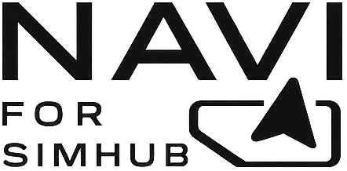

# NAVI FOR SIMHUB
  
This project provides a live map view similar to a navigation system and uses the SimHub JSON API to display the current position of the car on real-world race tracks. It is a proof of concept, currently tested with Forza Motorsport 8 and the Nordschleife and other Tracks. It should work for every other game supported by simhub that outputs X and Y Coordinates.

## Features

- Live updating of the car position on a map
- Realistic navigation-like view
- Uses real GPS coordinates for track mapping
- Mapping Helper to set reference points for new tracks
- POI Editor for corner names and landmarks

## How does it work?

A Python Flask server acts as a CORS proxy to fetch data from the SimHub JSON API. The frontend displays the car's position in real time on a Leaflet map.

To map in-game coordinates to real GPS positions, a minimum of three reference points are required for each track (more points = better accuracy).  
A reference point consists of the in-game coordinates and the corresponding GPS coordinates.

### Why Affine Transformation?

We use an affine transformation because game coordinates and GPS coordinates are not directly comparable. Rotation, translation, and different scales need to be accounted for, which can only be reliably achieved with at least three reference points.

## SimHub recordings from a Windows share

In **Config → Windows recording share**, enable sync, enter your Windows
account, and use **Find shares** on the SimHub host or enter the UNC path.
Share the SimHub installation or its `PluginsData` folder with read permission
for that account. On Debian-based hosts, install the optional SMB client
bindings for the Python interpreter used by Navi (`sudo apt install python3-smbc`).
Existing system mounts via `SIMHUB_RECORDINGS_ROOT` or `/mnt/simhub-recordings`
can still be selected. A new install without a mount starts with sync off.

Navi checks for new and changed `.shtl` files in `MapRecords` and
`MapRecordsCloud` every minute when sync is enabled. The copies are stored in
`~/.local/share/simhub-navi/recordings` by default. Set
`SIMHUB_RECORDINGS_CACHE` to choose a different local directory. Copies remain
available when sync is disabled, when Windows is offline, or after a file is
removed from the share. Manual uploads remain available through **Recordings**.

**Recordings** uses the local copies for previews and mapping, and lists the
newest recording per source and track. Select **Map** or **Remap** to open the
recording in Mapping Helper 2.

## Track names in Recordings and Mapping Helper 2

`track_names.json` ships with the app. Each entry maps a game-specific key or
alias to a circuit and layout name. A readable saved name takes priority, then
a readable SimHub display name, then the local catalog. A catalog match can
also supply the circuit name for the map search. Keys, POIs and reference
points keep their existing identities.

Catalog sources checked on 2026-11-23:

- FM8 has all 73 layout ordinals in the
  [published telemetry table](https://github.com/bluemanos/forza-motorsport-car-track-ordinal/blob/9877395abf1278908ed123d7d645ea11ef6ff550/fm8/tracks.csv).
  Local recordings confirm examples such as Brands Hatch GP and Nürburgring
  Endurance. The source license is in `track_names.LICENSES.txt`.
- PCars3 contains 138 circuit and layout labels with aliases based on the
  [publisher's course list](https://p-cars3.bn-ent.net/course/),
  [DLC list](https://p-cars3.bn-ent.net/dlc/),
  [Steam track asset names](https://steamdb.info/depot/958401/) and supplied
  SimHub recordings. The recordings verify these SimHub keys: `Azure_Circuit-GP`,
  `Bathurst-Mount_Panorama`, `Brands_Hatch-GP`, `Cadwell-Club`,
  `Hockenheimring-GP`, `AutodromoNazionaleMonza-GP`, `Nurburgring-GP`,
  `Nurburgring-Nordschleife`, and the cloud filename
  `Autodromo_Internazionale_Enzo_E_Dino_Ferrari_Imola-GP`.
  Other aliases use published game names and asset names.
- RRRE includes all 191 layout IDs and 80 circuit IDs in the
  [RaceRoom developer snapshot](https://github.com/kwstudios-sweden/r3e-spectator-overlay/blob/c9bcd098b427648050ba49ac1259514f81114d8a/r3e-data.json)
  from 2026-11-11. Local recordings confirm the older SimHub text keys for
  Nordschleife and Portimão Club.
- SIMBINRACE07 uses base game and expansion names from the
  [Race Injection manual](https://store.steampowered.com/manual/44680/), plus
  internal layout names from the
  [base game](https://steamdb.info/depot/8601/apps/),
  [GTR Evolution](https://steamdb.info/depot/8661/),
  [STCC](https://steamdb.info/depot/8691/), and
  [Race Injection expansion depots](https://steamdb.info/app/44680/depots/).
  These sources establish file keys such as `2007_Brands_Hatch`,
  `Nordschleife`, `2010_Falkenberg` and `MidOhio_chic`.

The supplied Forza Horizon 5 recordings for fictional courses use SimHub
`DT__…` keys. That prefix also appears in files that SimHub stores with
`GameCode: SIMBINRACE07`. Navi uses the recorded game code and track key
together. An unresolved key stays visible as recorded.

## Track data for clients

[static/track_reference_points.json](static/track_reference_points.json) stores entries
under `[GameCode][track key]`, using the identifiers from the SimHub `.shtl` recording.
For FM8, the key is `TrackName`, which SimHub's live JSON reports as
`NewData.TrackId`. For example, the Nürburgring Nordschleife is `["FM8"]["32"]`.
For PCars3, the key is `TrackName-TrackConfig` when a layout is present. PCars3
uses `Nurburgring-Nordschleife` and `Nurburgring-GP` for distinct layouts.

Each entry contains `display_name`, `yaw` and `ref_points`. Confirmed entries
also have `track_name` and, when present, `track_config` as recorded by SimHub.
The `aliases` list contains previous keys or names. Legacy tracks keep their
previous keys until the recording or live telemetry verifies their IDs.
The server derives its local transformations from this file at startup.
Track heading is `OrientationYaw * yaw_sign + yaw`, with `yaw_sign` defaulting
to `1` when absent. Helper 2 derives `yaw` from track alignment for FM8 and
PCars3. The other games can follow the rotation after a manual yaw calibration.
POIs use `static/poi/<GameCode>/<track key>.json`, for example
[`static/poi/FM8/32.json`](static/poi/FM8/32.json).

## Contributing

### Using the Mapping Helper Tool

To simplify the creation and management of reference points, you can use the built-in Mapping Helper tool. This tool eliminates the need to manually edit the `static/track_reference_points.json` file.

#### How to Use the Mapping Helper

1. Start the server as described in the "Getting Started" section.
2. Open your browser and navigate to `http://localhost:5015/helper`.
3. Use the interface to:
   - Add new reference points by providing in-game coordinates and corresponding GPS coordinates.
   - Adjust the yaw correction if the map rotation is incorrect.
   - Save your changes directly to the reference points file.
4. The tool automatically updates the transformations and ensures the data is valid.

This tool streamlines the process and reduces the risk of errors when adding or modifying reference points.

5. For now, please create a pull request with your changes or open an issue if you need help. (Sync Feature is planned for the future)

## Getting Started

1. Install the dependencies:

   ```
   pip install flask requests flask-cors numpy waitress
   ```

2. Start the server:

   ```
   python app.py
   ```

3. Open `localhost:5015` in your browser.
4. Edit Settings 
5. Start Mapping 
6. Enjoy the Map 

## Status

The project is in an early stage! More tracks and features are planned. Community contributions are very welcome!
